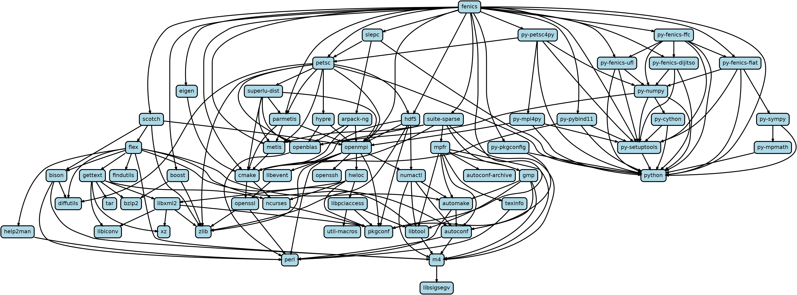

<style>
  .reveal strong {
    font-weight: bold;
    color: orange;
  }
  .reveal p {
    text-align: left;
  }
  .reveal section h1 {
    color: orange;
  }
  .reveal section h2 {
    color: orange;
  }
  .reveal code {
    font-family: 'Source Code Pro';
    color: orange;
  }
  .reveal section img {
    background:none;
    border:none;
    box-shadow:none;
  }
</style>

# Packaging for High-Performance Computing

---

## Learning goals

- Understand the challenges of deploying software to supercomputers.
- Use Spack to install software.
- Create a Spack package for your own software.

---

## Introduction 1/2

Scientific software installation on supercomputers faces challenges:

- Distributed infrastructure (MPI, OpenMP, HPX, ...)
- Special hardware (accelerators, network, ...)
- Greatly varying architectures (AMD/Intel x86-64, ARM, ...)
- Missing dependencies (too niche, too new, too old)
- Admins will not/cannot install software for you.
- You do not have superuser rights.

---

## Introduction 2/2

Performance is critical on supercomputers

- Software needs to be **compiled** to achieve the best performance (special libraries, compilers...).
- Optimized compilation settings (best settings not always obvious).
- Optimal settings depend on platform (supercomputers might be heterogeneous, for e.g., different generation of CPUs and GPUs).

**HPC-friendly package managers** can help with ...

- ... organizing software installations.
- ... compilation of software.
- ... reproducibility of performance.

---

## Dependency Graph of FEniCS



*Libraries, build tools, interpreters*

---

## Spack


[Project homepage (https://spack.io/)](https://spack.io/)

---

## Spack Introduction 1/2

- HPC-friendly package manager.
    - Common scientific software included.
    - Builds entire dependency tree from source.
    - No superuser rights needed.
    - Spack's [dependencies](https://spack.readthedocs.io/en/latest/getting_started.html#system-prerequisites) commonly available on supercomputers.
- Deals with variants, dependency resolution, compilation flags and compilation.
- Prefers to install newest version of packages.
- Can find and use external packages (good for compilers and tools).

---

## Spack Introduction 2/2

- [Open-source project on GitHub](https://github.com/spack/spack).
- Separate [package repository](https://github.com/spack/spack-packages).
- Valuable resources:
    - [Good starter guides](https://spack-tutorial.readthedocs.io/en/latest/).
    - [Extensive documentation](https://spack.readthedocs.io).
    - [Spack Slack](https://slack.spack.io/) for communication with community.
- Spack [bootstraps](https://spack.readthedocs.io/en/latest/bootstrapping.html) its own dependencies the first time it is used.

---

## Step by Step Plan

- **Goal**: Create a Spack package for a HelloWorld code.
- Steps:
    1. Install and configure Spack.
    2. Learn how to use Spack for package management and installation.
    3. Create a Spack package for a HelloWorld code.
- Code is on GitHub: [HelloWorld](https://github.com/Simulation-Software-Engineering/HelloWorld).

---

## Demo 1: Spack Installation

---

## Spack Configuration and Caches

- Set up Spack by

  ```bash
  . <spack_prefix>/share/spack/setup-env.sh
  ```

    - Add this command to `.bashrc` to make permanent.
    - Defines `SPACK_ROOT` pointing to local Spack directory.
- Spack relies on `yaml` files.
    - Take care of spaces when editing (2 space indent).
- User configuration in `${HOME}/.spack`.
- Several [other configuration scopes](https://spack.readthedocs.io/en/latest/configuration.html).

---

## General Spack Usage

- Spack works with `spec`s (`spec`=specification), for example

  ```bash
  spack install cmake@3.31 +doc -ncurses ~qtgui
  ```

  A spec may be more precise than just a package name.

    - `+` selects some option
    - `~`/`-` deselects some option
    - `cppflags="..."` adds additional compilation flags
    - `^ SPEC` constrains dependencies

- Loading and unloading of specs by

  ```bash
  spack load cmake@3.31
  spack unload cmake@3.31
  ```

---

## Demo 2: Package Installation and Management

---

## Common Spack Commands 1/2

- `spack find`:
    - Show packages in root environment.
- `spack spec SPEC`:
    - Show packages that would be installed for specified package.
- `spack install SPEC`:
    - Installs package.
- `spack uninstall SPEC`:
    - Uninstalls package.
- `spack load SPEC`:
    - Loads package into current environment.
- `spack unload SPEC`:
    - Removes package from current environment.

---

## Common Spack Commands 2/2

- `spack info PKG`:
    - Shows information about given package.
- `spack remove SPEC`:
    - Removes a spec from current environment.
- `spack repo ...`:
    - Manages package repositories
- `spack gc`:
    - Garbage collection, removes all packages not needed in any environment.
    - Will remove compile-time/link-time dependencies.

---

## Demo 3: Package Creation

- Create package for our [HelloWorld](https://github.com/Simulation-Software-Engineering/HelloWorld) code.
- Steps:
    1. Create boilerplate package
    2. Add package details
    3. Verify package
    4. Model dependencies and add variants

---

## Spack Packaging

- By default, packages reside in

  ```bash
  .spack/package_repos/*user*/repos/spack_repo/builtin/packages/
  ````

- `package.py` inside `PACKAGENAME/` describes installation routine.
- Installation recipes are Python code.
    - You can write own logic/helper functions in your recipe.
    - Reasonable code highlighting.

---

## Helpful Spack Packaging Commands

- `spack create --template T URL`
    - Creates boilerplate package using a build system template.
    - Build system `T` can be make, cmake, python, cargo, ...
    - `URL` points to some archive one can download.
- `spack edit PKG`:
    - Open given Spack package in editor.
    - Set `EDITOR` environment variable to control what editor is used.
- `spack info PKG`:
    - Shows information about given package.

---

## Common Spack Package Properties 1/3

- Package class definition

  ```python
  class Packagename(CMakePackage)
  ```

- Homepage URL

  ```python
  homepage = "https://..."
  ```

- Download URL of package

  ```python
  url = "https://...archive/refs/tags/v0.3.0.tar.gz"
  ```

  Points to archive (`.tar.gz`, `.zip`...)

- Optional: Git repository

  ```python
  git = "https://somewhere/projectname.git"
  ```

---

## Common Spack Package Properties 2/3

- Version number and hash of its archive

  ```python
  version("0.2.0", sha256="a77499bbfd0...")
  ```

- Version name and branch of repository

  ```python
  version("develop", branch="develop")
  ```

- Variants

  ```python
  variant("debug_log", default=True, description="Enable DEBUG log.")
  variant("assertions", default=False, description="Enable asserts.")
  ```

---

## Common Spack Package Properties 3/3

- Dependency specification

  ```python
  depends_on("PACKAGE@VERSION", when="CONDITION")
  ```

  Example:

  ```python
  variant("python", default=True, description="Enable Python support")

  depends_on("python@3:", when="+python")
  depends_on("python@3.10:", when="@4: +python")
  ```

- `@3:`, `@:3`, `@2:3`:
    - Minimum, maximum version and version range.
    - Version numbers are **inclusive**.
    - `@2:3`: Any version starting with `2` or `3`.
    - Generally use semantic versioning, e.g., `@2.3.1:2.4`.

---

## Spack Environments

- Spack can create [environments](https://spack.readthedocs.io/en/latest/environments_basics.html).
- `spack find` shows packages in current environment.
- By default you are in "root" environment.
    - The "root" environment contains all packages installed/known by Spack.
- Environment has its own `view`.
    - Only sees specs added to this environment.
- Environments can be named for easier identification.

---

## Common Spack Environments Commands

- `spack env list`:
    - List available environments.
- `spack env create ENV`:
    - Create new environment with name `ENV`.
- `spack env activate -p ENV`:
    - Activate environment `ENV` and prepend name to terminal.
- `spack env deactivate`:
    - Deactivate a terminal (alternative: `despacktivate`).
- `spack env remove -p ENV`:
    - Remove environment `ENV`.
- `spack add SPEC`:
    - Add `SPEC` to environment without installing.
- `spack concretize`:
    - Concretize the specs of active environment.

---

## Advanced Features

- Reproducible [builds](https://spack-tutorial.readthedocs.io/en/latest/tutorial_environments.html#building-in-environments) and [environments](https://spack-tutorial.readthedocs.io/en/latest/tutorial_environments.html).
- Own [mirrors and caches](https://spack-tutorial.readthedocs.io/en/latest/tutorial_binary_cache.html).
- [Container images](https://spack.readthedocs.io/en/latest/containers.html).
- [Chained installation](https://spack.readthedocs.io/en/latest/chain.html).
- [Stacks (build matrices)](https://spack-tutorial.readthedocs.io/en/latest/tutorial_stacks.html).
- [Software management (modules)](https://spack.readthedocs.io/en/latest/module_file_support.html).

---

## Package Managers for HPC 1/2

- Popular package managers for HPC.
    - [Spack](https://spack.io/)
        - ... originates from LLNL in the US.
        - ... is built around concretizer.
        - ... captures what can be built.
    - [EasyBuild](https://github.com/easybuilders/easybuild)
        - ... originates from Ghent University in Belgium.
        - ... captures configurations that are known to work.
- Both suitable for users, admins, researchers.
- Package managers introduce additional complexity -> Alternatives?
    - Manual installation and module system like [`Lmod`](https://lmod.readthedocs.io/en/latest/) or [`Modules`](http://modules.sourceforge.net/).
- General Problem: Compilation times/options.
    - Solution: Build caches/precompiled codes?

---

## Package Managers for HPC 2/2

- [European Environment for Scientific Software Installations (EESSI)](https://eessi.github.io/docs/).
    - Initiated in Europe.
    - Focus on avoiding recompilation.
    - Targets workstations/PCs, supercomputers and cloud computing.
    - Built on EasyBuild
- [Extreme-scale Scientific Software Development Kit (xSDK)](https://xsdk.info/).
    - Initiated in the US.
    - Currently strong focus on mathematical software.
    - Focuses on defining requirements scientific should adhere to (build system, testing, documentation, etc.).
    - Built on Spack
- Both focus on specifying basic software stack for HPC.

---

## Further Reading

- [EasyBuild](https://github.com/easybuilders/easybuild)
- [EasyConfigs](https://github.com/easybuilders/easybuild-easyconfigs)
- [Spack](https://spack.io/)
- [Spack docs](https://spack.readthedocs.io/en/latest/)
- [Spack 101 tutorials](https://spack-tutorial.readthedocs.io/en/latest/)
- [archspec project](https://github.com/archspec/)

---

## Presentations

- [Spack v1.0 and Beyond: Managing HPC Software Stacks](https://archive.fosdem.org/2026/schedule/event/DHUQAN-spack-one-zero-and-beyond/)
- [Spack's new Concretizer](https://archive.fosdem.org/2020/schedule/event/dependency_solving_not_just_sat/)
- [Build for your microarchitecture: experiences with Spack and archspec](https://archive.fosdem.org/2020/schedule/event/archspec/)
- [Binary packaging for HPC with Spack](https://archive.fosdem.org/2018/schedule/event/llnl_spack/)
- [How To Make Package Managers Cry](https://archive.fosdem.org/2018/schedule/event/how_to_make_package_managers_cry/)
- [Software Packages in HPC with Spack and EasyBuild](https://www.archer2.ac.uk/training/courses/200617-spack-easybuild/)
